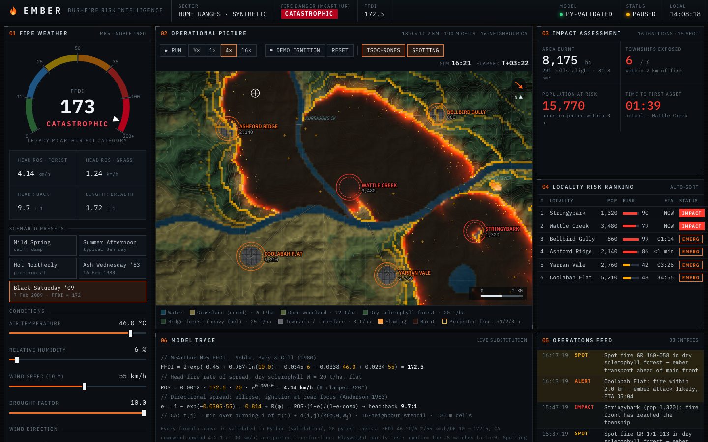

# EMBER · Bushfire Risk Intelligence

**A fire-agency style operations console that turns weather into fire danger, fire danger into spread, and spread into township impact, live in the browser.**
The science is validated in Python first, then ported line for line to JavaScript and checked against the Python output to 1e-9.

### ▶ Live demo: **[nrjalela.github.io/ember](https://nrjalela.github.io/ember/)**



---

## What it does

| | |
|---|---|
| **Fire danger** | Live McArthur Mk5 Forest Fire Danger Index gauge, coloured by the legacy McArthur FDI categories (Low-Moderate → Catastrophic) |
| **Weather controls** | Draggable wind compass; sliders for temperature, humidity, wind speed and drought factor; a one-click south-westerly wind change |
| **Scenarios** | Mild Spring, Summer Afternoon, Hot Northerly, Ash Wednesday '83, Black Saturday '09 (FFDI ≈ 172) |
| **Fire spread** | Click anywhere to ignite. A cellular-automaton model spreads the fire over procedural terrain (forest ridges, grass valleys, rivers, a reservoir), with ember glow, ember spotting and 1/2/3-hour projected fire-front lines |
| **Impact** | Area burnt, townships exposed, population at risk, time to first asset (projected, then actual) |
| **Risk ranking** | The six townships re-rank live by status, ETA and an exposure index built from fuel hazard and upwind fuel |
| **Ops feed** | A timestamped log of ignitions, spot fires, weather changes, danger-band changes and township alerts |
| **Model trace** | Every equation is shown with the current values substituted, so you can audit the numbers on screen |

It works on desktop, tablet and phone. The whole site is one `index.html` with no build step and no framework.

## The validated science

All model maths lives in [`validation/ember_model.py`](validation/ember_model.py) and is covered by **28 pytest checks** ([`validation/test_ember.py`](validation/test_ember.py)). None of it went into the UI until every check passed.

| Component | Formula | Key validation |
|---|---|---|
| **Fire danger** (Noble, Bary & Gill 1980) | `FFDI = 2·exp(−0.45 + 0.987·ln DF − 0.0345·RH + 0.0338·T + 0.0234·V)` | 46 °C, 6 % RH, 55 km/h, DF 10 → **172.5** ✓ |
| **Danger bands** | Legacy McArthur FDI categories: 0 / 12 / 25 / 50 / 75 / 100+ | Every band boundary tested |
| **Rate of spread** (McArthur Mk5 forest) | `ROS = 0.0012 · FFDI · W · e^(0.069·θ)` km/h, slope θ clamped to ±20° | Linear in FFDI and fuel; **doubles per +10° upslope**, halves per 10° downslope |
| **Directional spread** (Anderson 1983 shape) | `R(φ) = ROS·(1−e)/(1−e·cos φ)`, `e = 1 − exp(−k·V)` | Head:back ratio exactly **4:1 at 30 km/h** |
| **Fire-spread CA** | Each cell ignites at the earliest `t(i) + d(i,j) / R(φ, θ, Wⱼ)` over its 16 neighbours; water and fuel breaks block spread | Downwind:upwind **4.2:1** ✓, elliptical scar within 10 % of π·a·b ✓, circular in calm ✓, 4:1 upslope ✓, rivers stop the fire ✓, safe mid-fire recompute after a wind change ✓ |

**JS ↔ Python parity.** [`validation/export_fixtures.py`](validation/export_fixtures.py) exports reference outputs. [`tests/parity.spec.js`](tests/parity.spec.js) runs the browser port against them, including a full arrival-time map on a landscape with a hill and a river. Every cell matches to a relative error below **1e-9**.

**Honest limits.** This is an educational model on synthetic terrain.
- It uses the forest meter everywhere. Operationally, grassland uses the McArthur *Grassland* meter (GFDI).
- Spotting is a probabilistic heuristic and is not validated.
- Fuel loads are static.
- It is **not** an operational tool.

## Testing

```bash
npm run validate      # 28 pytest checks on the science
npx playwright test   # 17 browser tests
```

The Playwright suite checks:
- zero console errors
- every preset lands in the right band
- sliders drive the gauge
- the compass works by drag and by keyboard
- click-to-ignite spreads the fire and updates the KPIs
- the demo fire reaches a township
- water can't be ignited
- pause and reset work
- JS/Python parity
- layout at 1440, 1200, 834 and 390 px: no horizontal scroll, tables fit, screenshots saved to [`screenshots/`](screenshots/)

## Tech stack

- **Science:** Python 3.13, pytest. The model uses only the standard library, so it's easy to audit.
- **App:** vanilla JavaScript, HTML Canvas 2D (procedural value-noise terrain, hillshade, contours, additive-blend fire glow and ember particles), inline SVG instruments, CSS Grid.
- **Algorithm:** the fire spread is a minimum-travel-time cellular automaton. It uses Dijkstra's algorithm with a binary heap on a 180 × 112 grid of 100 m cells, 16-neighbour stencil, so a full recompute takes a few milliseconds.
- **Testing:** Playwright (Chromium).
- **Hosting:** GitHub Pages, with Open Graph and Twitter cards for link previews.

## Run locally

```bash
python3 -m http.server 8000   # then open http://localhost:8000
```

To run the tests:

```bash
python3 -m venv .venv && .venv/bin/pip install -r validation/requirements.txt
npm install && npx playwright install chromium
npm run validate && npx playwright test
```

## What I'd build next

1. **Real weather.** Pull Bureau of Meteorology observations and gridded forecasts (ADFD) so the FFDI and wind update each hour for a real location, with KBDI/SDI soil-dryness data driving the drought factor.
2. **Real landscapes.** Use GIS data: a DEM (Geoscience Australia 1-sec SRTM), state fuel-type and fuel-hazard layers, fire history for time-since-fire fuel loads, and ABS mesh blocks for population. Serve them as Cloud-Optimised GeoTIFFs and render on MapLibre GL.
3. **Migrate to the Australian Fire Danger Rating System (AFDRS, 2022).** Replace the legacy McArthur categories with the four-level AFDRS scale (Moderate / High / Extreme / Catastrophic) and its fuel-specific fire-behaviour models (e.g. Vesta Mk2 for dry eucalypt forest, CSIRO grassland).
4. **Uncertainty.** Run ensemble fire spread across weather-forecast members and show burn probability instead of a single scar.
5. **Validation against real fires.** Hindcast historical fire perimeters (e.g. Kilmore East 2009) and report spread-rate and shape error.
6. **Operational features.** Evacuation-route exposure along the road network, suppression and containment-line scenarios, and exportable situation reports.

## References

- McArthur, A.G. (1967). *Fire behaviour in eucalypt forests.* Leaflet 107, Forestry and Timber Bureau, Canberra.
- Noble, I.R., Bary, G.A.V. & Gill, A.M. (1980). McArthur's fire-danger meters expressed as equations. *Australian Journal of Ecology* 5, 201–203.
- Anderson, H.E. (1983). *Predicting wind-driven wild land fire size and shape.* USDA Forest Service Research Paper INT-305.

---

Built by [@nrjalela](https://github.com/nrjalela) · MIT licence · Township names and terrain are fictional. In a real emergency, follow your state fire agency.
